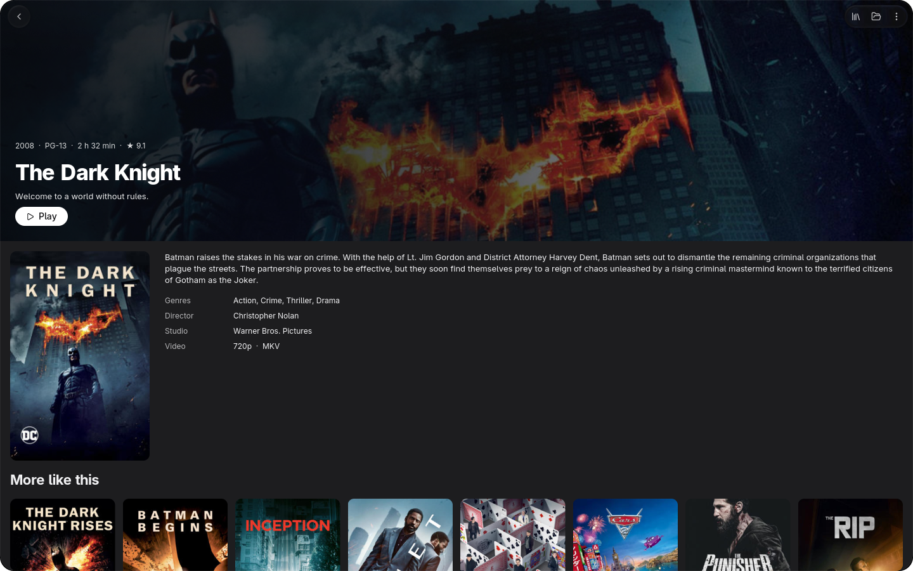
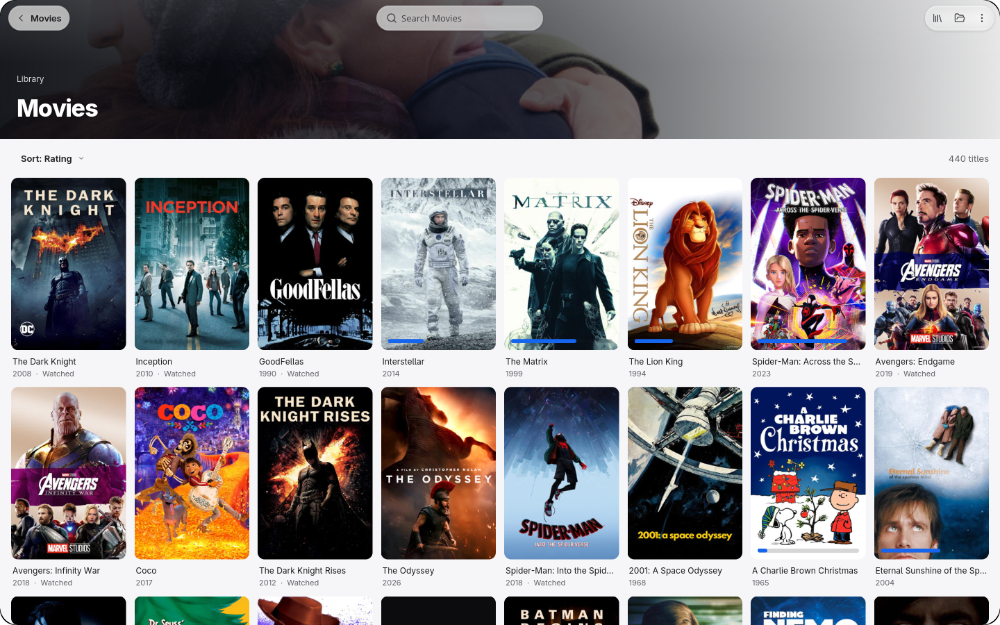
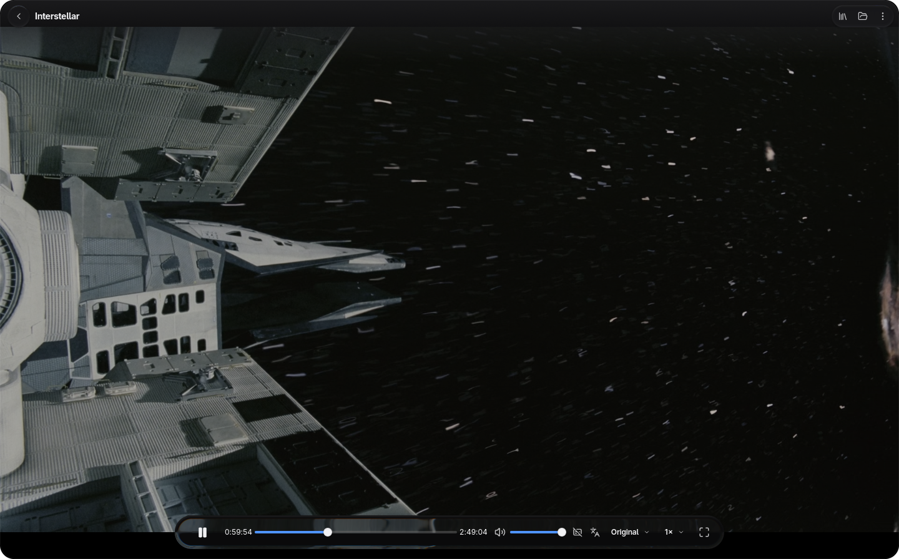
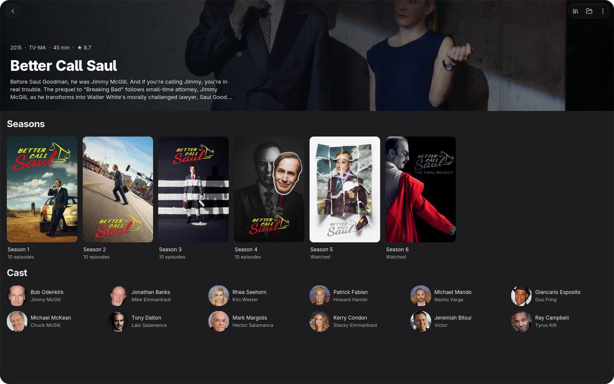
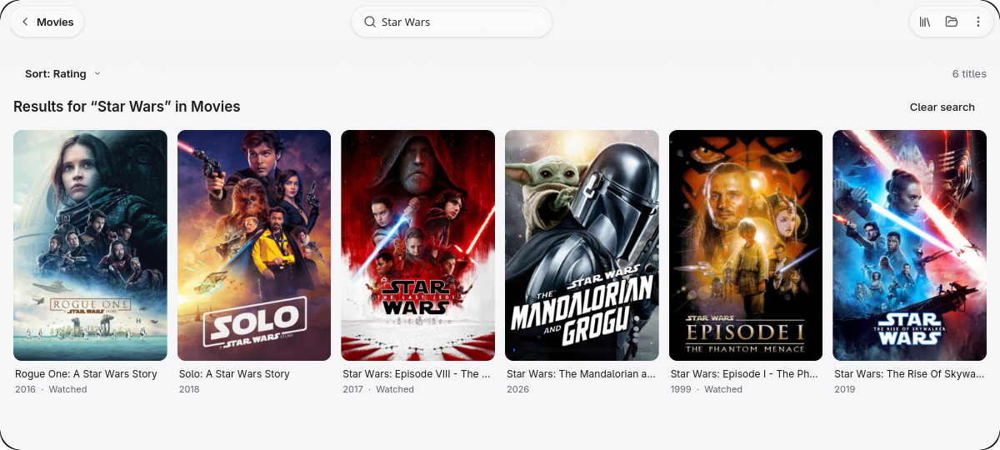

# Video

A native video player and media-server client built with
[enzUI](https://github.com/enz1m/enzui). Watch local videos and network streams,
or browse Plex, Jellyfin and Emby libraries.

<p align="center">
  <a href="docs/screenshots/dark-knight.png"></a>
  <br><sub>The Dark Knight · Plex movie details in dark mode</sub>
</p>

<table>
  <tr>
    <td align="center"><a href="docs/screenshots/movies-by-rating.png"></a><br><sub>Movies by rating</sub></td>
    <td align="center"><a href="docs/screenshots/interstellar-playback.png"></a><br><sub>Interstellar · Plex playback</sub></td>
  </tr>
  <tr>
    <td align="center"><a href="docs/screenshots/better-call-saul.png"></a><br><sub>Better Call Saul · Seasons and cast</sub></td>
    <td align="center"><a href="docs/screenshots/star-wars-search.png"></a><br><sub>Star Wars · Library search</sub></td>
  </tr>
</table>

Click any screenshot to enlarge. The screenshots show Video connected to Plex.
Film images and library artwork belong to their respective rights holders.

## Features

- Local and network playback with seeking, volume, speed, audio and subtitle controls.
- Queues, native drag and drop, recent media, resume positions and session persistence.
- Plex, Jellyfin and Emby browsing, search, artwork, movie details and episode navigation.
- Account/profile isolation, protected profiles and keyring-backed credentials.
- System/theme fonts, light and dark themes, and partial French/Arabic translations.

## Build and run

Use Rust **1.99.1** and the native development libraries for GStreamer
(base/video/audio/app), GLib/GIO, Wayland/XKB and Vulkan/EGL. A C/C++ compiler and pkg-config are required. The
minimum supported Rust version is **1.95**. Install GStreamer plugins for your
media; base, good, bad, ugly and libav provide broad codec coverage.

```sh
git clone https://github.com/enz1m/video.git
cd video
cargo fetch --locked
cargo build --locked
cargo run --locked -- /path/to/video.mkv
cargo run --locked -- --plex
```

The lockfile pins [enzUI](https://github.com/enz1m/enzui) and its foundation forks.
Cargo fetches them from GitHub. Wayland is the default. Build with
`--features x11` to enable X11.

## Opening media

Use the titlebar file control, a native file drop, a command-line path or Linux
“Open With”. Desktop file/URI launches forward to the running app. The
[desktop entry](assets/io.github.enzui.Video.desktop) advertises the supported
video types. Register the entry and SVG icon with your desktop environment to
make Video appear in “Open With”; registration does not change default file
associations. Folders queue recognized video
extensions; individual files are probed by content. Use `--` before a filename
beginning with a dash.

See [format support](docs/FORMAT_SUPPORT.md) for containers, subtitles and codec
requirements, and [media services](docs/MEDIA_SERVICES.md) for discovery,
authentication and current service limitations. `--plex-server URL` connects to
a specified Plex address. The player's quality menu plays the original file or
asks the server for a transcode from 20 Mbps 1080p down to 720 kbps 360p;
offline downloads are not implemented.

Preferences, resume state and thumbnails use `$XDG_DATA_HOME/enzui-video`
(normally `~/.local/share/enzui-video`). `ENZUI_VIDEO_STATE_DIR` can select isolated
state for development. Tokens remain in Secret Service and are excluded from
preferences and diagnostics. Missing or locked keyring access leaves sign-in
session-only when possible.

The shared enzUI theme and the `io.github.enzui.Video` override apply live to the
player and sign-in window. The interface uses system/theme fonts.

## Development

```sh
cargo fmt --all -- --check
ICED_TEST_BACKEND=software cargo test --locked --all-features -- --test-threads=1
cargo clippy --locked --all-targets --all-features -- -D warnings
```

The compact suite uses synthetic local media and loopback servers. No real media
account is needed. Keep private libraries, account data and temporary captures
outside version control.

Licensed under [MIT](LICENSE).
